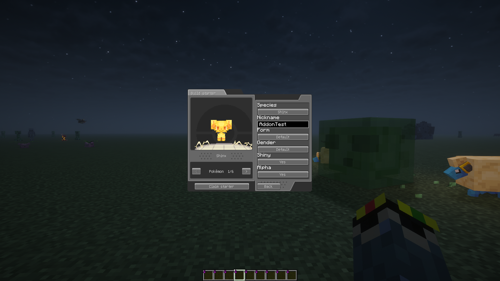
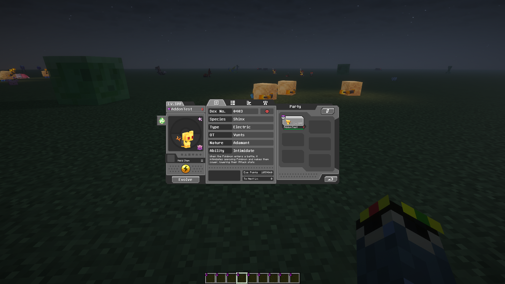

# Starter Customizer

Starter Customizer adds a **Build starter** button to Cobblemon’s starter screen. Search the installed Pokémon roster, customize your choice, and claim it as your first partner.

## Compatibility

| Requirement | Public beta |
| --- | --- |
| Minecraft | Java Edition 1.21.1, running on Java 21 |
| Mod loader | NeoForge 21.1.265 or newer in the Minecraft 1.21.1 branch |
| Cobblemon | NeoForge 1.8.x. Build verification targets 1.8.0 and 1.8.4. |
| Kotlin for Forge | Cobblemon 1.8.0 declares 5.3 or newer. Cobblemon 1.8.4 declares 5.10 or newer. The development build uses 5.13.0. Follow the minimum for your installed Cobblemon version. |

## Install

- **Client and single-player** — Install NeoForge 1.21.1, then put the Starter Customizer, Cobblemon NeoForge, and Kotlin for Forge JARs in the instance’s `mods/` folder. In Modrinth App, use **⋯ → Open folder** to find that folder.
- **Multiplayer** — Put those three JARs in the NeoForge server’s `mods/` folder and restart it. Each player needs the matching Starter Customizer, Cobblemon, and Kotlin for Forge setup in their client instance.

## Choose a starter

1. Open Cobblemon’s initial starter selection while your character is eligible. On the default keybind, press **M**.
2. Click **Build starter** at the bottom right.
3. Click **Choose Pokémon** to browse or search the roster, including implemented species from installed mods and datapacks. Use the **Sort** button to cycle through name A–Z, National Pokédex number, and highest base stat total. Base stat totals use the species’ standard form. Use the arrows to configure nature, ability, moves, and stats. A blank level uses the level of the first configured starter.
4. Click **Claim starter** to add the Pokémon to your party. **Back** returns to Cobblemon’s usual choices.

Cobblemon controls starter eligibility and applies its shiny-starters gamerule.

Run `/startercustomizer set eevee nickname=Nova shiny=true` to save a preset for the standard selection flow. Use `show`, `update`, `clear`, and `choose` to manage the preset or open the starter screen.

## Screenshots

## Supported properties

Use an implemented species ID followed by space-separated `key=value` options. You can use a namespaced species ID for an installed datapack Pokémon.

| Options | Values |
| --- | --- |
| `form`, `gender`, `nickname`, `shiny`, `alpha` | Cobblemon’s form ID, a gender, a single-word nickname, or `true`/`false` for toggles |
| `level`, `friendship`, `scale_modifier` | 1–100, 0–255, and 0.5–2 respectively |
| `ability`, `nature`, `pokeball`, `tera_type` | Cobblemon registry names |
| `moves` | Up to four comma-separated move IDs |
| `dmax_level`, `gmax_factor` | 0–10 and `true`/`false` |
| `min_perfect_ivs`, `<stat>_iv`, `<stat>_ev` | 0–6, 0–31, and 0–252 respectively. EVs must total at most 510. |

Stat IDs are `hp`, `attack`, `defence`, `special_attack`, `special_defence`, and `speed`. Cobblemon applies the properties using its Pokémon creation rules.

## Build

Run `./gradlew clean build` with Java 21. The addon JAR is in `build/libs/`. The default Cobblemon compile target is 1.8.0. Use `./gradlew build -Pcobblemon_version_id=xsVHrAsY` to compile against 1.8.4.

## License

Starter Customizer source is distributed under the [MIT License](LICENSE). [Template files](TEMPLATE_LICENSE.txt) retain the NeoForged notice. The game loads the starter screen textures and models from the installed Cobblemon mod.
